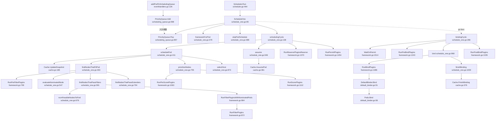

# Kubernetes Scheduler 主干调用链（v1.32 代码）

> 用途：熟悉 scheduler 组件单 Pod 调度流程。只覆盖主干，旁支（抢占、extender 打分、队列 backoff）单独学。
> 行号基于本仓库 `pkg/scheduler/**` 的实际内容。

---

## 0. 一句话心智模型

调度器只有两个阶段：**同步的 scheduling cycle（选节点 + 在 cache 里记账）** 和 **异步的 binding cycle（真正写 apiserver）**。
中间的 `RunXxx` 全部是"遍历插件列表 + 记 metrics"，没有算法；算法都在插件里。

---

## 1. 链路（纯文本大纲，Ctrl+C 复制、Ctrl+V 粘贴到飞书即变成嵌套列表）

调度器主干：Informer → 队列 → 同步调度周期 → 异步绑定周期

- 入口与主编排
  - `eventhandlers.go:126 addPodToSchedulingQueue` —— Informer 的 Pod add 回调，把未绑定 Pod 入队；无返回值，副作用是 `SchedulingQueue.Add`
  - `scheduling_queue.go:598 PriorityQueue.Add` —— 包装成 QueuedPodInfo 放入 activeQ 并唤醒消费者；无返回值
  - `scheduler.go:464 Scheduler.Run` —— 启动队列，并起 goroutine 反复执行 `ScheduleOne`；无返回值
  - `schedule_one.go:65 ScheduleOne` —— 单 Pod 全流程编排（同步调度 + 异步绑定）；无返回值
  - `scheduling_queue.go:857 PriorityQueue.Pop` —— 阻塞取下一个 Pod；返回 QueuedPodInfo 给 `ScheduleOne`
  - `schedule_one.go:379 frameworkForPod` —— 按 schedulerName 找 profile；返回 Framework 给后续所有插件调用
  - `schedule_one.go:388 skipPodSchedule` —— 跳过删除中/已 assume 的 Pod；返回 bool 给 `ScheduleOne`
  - `schedule_one.go:138 schedulingCycle` —— 同步阶段总控：选节点 → assume → reserve → permit；返回 (ScheduleResult, assumedPodInfo, Status) 给 `ScheduleOne`
- 过滤阶段（找可行节点）
  - `schedule_one.go:411 schedulePod` —— 选节点主流程：刷快照 → 过滤 → 打分 → 选优；返回 ScheduleResult 给 `schedulingCycle`
  - `cache.go:186 Cache.UpdateSnapshot` —— 把 cache 增量同步进 nodeInfoSnapshot；返回 error 给 `schedulePod`
  - `schedule_one.go:463 findNodesThatFitPod` —— 过滤编排：PreFilter → 提名节点 → Filter → Extender；返回 ([]NodeInfo, Diagnosis, error) 给 `schedulePod`
  - `framework.go:709 RunPreFilterPlugins` —— 顺序执行 PreFilter，可缩小节点子集；返回 (PreFilterResult, Status, 不可调度插件集合) 给 `findNodesThatFitPod`
  - `schedule_one.go:547 evaluateNominatedNode` —— 有 NominatedNodeName 时优先只验该节点；返回 []NodeInfo 给 `findNodesThatFitPod`
  - `schedule_one.go:591 findNodesThatPassFilters` —— 用 Parallelizer 并行对每个节点跑 Filter；返回节点列表给 `findNodesThatFitPod`
  - `schedule_one.go:676 numFeasibleNodesToFind` —— 算"找到多少可行节点就停"（百分比，最少 100）；返回 int32 给 `findNodesThatPassFilters`
  - `framework.go:984 RunFilterPluginsWithNominatedPods` —— 带 nominated pod 的 Filter，必要时跑两轮；返回 Status 给每个节点的 checkNode
  - `framework.go:872 RunFilterPlugins` —— 遍历 Filter 插件组，遇错即停；返回 Status 给 `RunFilterPluginsWithNominatedPods`
  - `schedule_one.go:704 findNodesThatPassExtenders` —— 串行调用 extender.Filter；返回节点列表给 `findNodesThatFitPod`
- 打分与选优
  - `schedule_one.go:755 prioritizeNodes` —— 打分编排：PreScore → Score →（可选）extender 加权；返回 []NodePluginScores 给 `selectHost`
  - `framework.go:1063 RunPreScorePlugins` —— 生成打分阶段共享状态；返回 Status 给 `prioritizeNodes`
  - `framework.go:1112 RunScorePlugins` —— 插件并行打分并按权重累加；返回 []NodePluginScores 给 `prioritizeNodes`
  - `schedule_one.go:873 selectHost` —— 堆取最高分，同分节点 reservoir sampling 打散；返回 host 给 ScheduleResult.SuggestedHost
- 预留、绑定、写回
  - `schedule_one.go:946 assume` —— 写 NodeName，让 cache 先记账（乐观假设）；返回 error 给 `schedulingCycle`
  - `cache.go:361 Cache.AssumePod` —— Pod 记入 assumedPods 与节点资源账本；返回 error 给 `assume`
  - `framework.go:1370 RunReservePluginsReserve` —— 执行 Reserve（真正资源预留）；返回 Status 给 `schedulingCycle`
  - `framework.go:1454 RunPermitPlugins` —— 执行 Permit，可返回 Wait 挂起；返回 Status 给 `schedulingCycle`
  - `schedule_one.go:266 bindingCycle` —— 异步阶段总控：等 Permit → PreBind → Bind → PostBind；返回 Status 给 `ScheduleOne` 的 goroutine
  - `framework.go:1514 WaitOnPermit` —— 阻塞等待 Permit 放行；返回 Status 给 `bindingCycle`
  - `framework.go:1243 RunPreBindPlugins` —— 绑定前最后一次可拒绝的准备动作；返回 Status 给 `bindingCycle`
  - `schedule_one.go:968 bind` —— 绑定入口：先 extender 后插件，defer `finishBinding`；返回 Status 给 `bindingCycle`
  - `framework.go:1286 RunBindPlugins` —— 遍历 Bind 插件；返回 Status 给 `bind`
  - `default_binder.go:51 DefaultBinder.Bind` —— 默认 Binder，构造 v1.Binding；返回 Status 给 `RunBindPlugins`
  - `default_binder.go:58 Pods.Bind` —— **链路终点**：POST /api/v1/namespaces/{ns}/pods/{name}/binding；返回 error 给 `DefaultBinder.Bind`
  - `schedule_one.go:1000 finishBinding` —— 绑定收尾：确认或清理 assumed 状态；无返回值
  - `cache.go:376 Cache.FinishBinding` —— 标记绑定完成，assumed 记录可过期；返回 error 给 `finishBinding`
  - `framework.go:1335 RunPostBindPlugins` —— 绑定成功后的通知类回调；无返回值

---

## 2. 链路图（Mermaid 源码）

> 飞书文档的代码块对 Mermaid 的渲染支持因版本而异。若不渲染：
> 1) 打开 https://mermaid.live ，Ctrl+C 复制下面代码、Ctrl+V 粘贴进去，导出 PNG，再插入飞书；
> 2) 或直接用飞书画板照第 1 节的大纲画。

---

## 3. 节点三要素表

| 函数 @ 位置 | 一句话职责 | 返回值 → 消费者 |
|---|---|---|
| `addPodToSchedulingQueue` @ eventhandlers.go:126 | Informer 的 Pod add 回调，入队 | 无；副作用 `SchedulingQueue.Add` |
| `PriorityQueue.Add` @ scheduling_queue.go:598 | 包装 QueuedPodInfo 放入 activeQ | 无；唤醒 `Pop` |
| `Scheduler.Run` @ scheduler.go:464 | 启动队列 + 循环执行 ScheduleOne | 无 |
| `ScheduleOne` @ schedule_one.go:65 | 单 Pod 全流程编排 | 无；内部产出 ScheduleResult |
| `PriorityQueue.Pop` @ scheduling_queue.go:857 | 阻塞取下一个 Pod | QueuedPodInfo → ScheduleOne |
| `frameworkForPod` @ schedule_one.go:379 | 按 schedulerName 选 profile | Framework → 后续插件调用 |
| `skipPodSchedule` @ schedule_one.go:388 | 跳过删除中/已 assume 的 Pod | bool → ScheduleOne |
| `schedulingCycle` @ schedule_one.go:138 | 同步阶段总控 | (ScheduleResult, assumedPodInfo, Status) → ScheduleOne |
| `schedulePod` @ schedule_one.go:411 | 刷快照→过滤→打分→选优 | ScheduleResult → schedulingCycle |
| `Cache.UpdateSnapshot` @ cache.go:186 | cache 增量同步进快照 | error → schedulePod |
| `findNodesThatFitPod` @ schedule_one.go:463 | 过滤阶段编排 | ([]NodeInfo, Diagnosis, error) → schedulePod |
| `RunPreFilterPlugins` @ framework.go:709 | 执行 PreFilter，可缩小节点集 | (PreFilterResult, Status, Set) → findNodesThatFitPod |
| `evaluateNominatedNode` @ schedule_one.go:547 | 优先验证提名节点 | []NodeInfo → findNodesThatFitPod |
| `findNodesThatPassFilters` @ schedule_one.go:591 | 并行跑 Filter | []NodeInfo → findNodesThatFitPod |
| `numFeasibleNodesToFind` @ schedule_one.go:676 | 算可行节点阈值 | int32 → findNodesThatPassFilters |
| `RunFilterPluginsWithNominatedPods` @ framework.go:984 | 带提名 Pod 的 Filter | Status → checkNode |
| `RunFilterPlugins` @ framework.go:872 | 遍历 Filter 插件 | Status → 上一层 |
| `findNodesThatPassExtenders` @ schedule_one.go:704 | 串行跑 extender.Filter | []NodeInfo → findNodesThatFitPod |
| `prioritizeNodes` @ schedule_one.go:755 | 打分编排 | []NodePluginScores → selectHost |
| `RunPreScorePlugins` @ framework.go:1063 | 生成打分共享状态 | Status → prioritizeNodes |
| `RunScorePlugins` @ framework.go:1112 | 并行打分加权求和 | []NodePluginScores → prioritizeNodes |
| `selectHost` @ schedule_one.go:873 | 取最高分并打散 | host → ScheduleResult.SuggestedHost |
| `assume` @ schedule_one.go:946 | 写 NodeName + cache 记账 | error → schedulingCycle |
| `Cache.AssumePod` @ cache.go:361 | assumedPods 记账 | error → assume |
| `RunReservePluginsReserve` @ framework.go:1370 | 执行 Reserve | Status → schedulingCycle |
| `RunPermitPlugins` @ framework.go:1454 | 执行 Permit（可 Wait） | Status → schedulingCycle |
| `bindingCycle` @ schedule_one.go:266 | 异步阶段总控 | Status → ScheduleOne goroutine |
| `WaitOnPermit` @ framework.go:1514 | 等 Permit | Status → bindingCycle |
| `RunPreBindPlugins` @ framework.go:1243 | 绑定前准备 | Status → bindingCycle |
| `bind` @ schedule_one.go:968 | 绑定入口 + 收尾 defer | Status → bindingCycle |
| `RunBindPlugins` @ framework.go:1286 | 遍历 Bind 插件 | Status → bind |
| `DefaultBinder.Bind` @ default_binder.go:51 | 构造 Binding | Status → RunBindPlugins |
| `Pods.Bind` @ default_binder.go:58 | **写回 apiserver** | error → DefaultBinder.Bind |
| `finishBinding` @ schedule_one.go:1000 | 绑定收尾 | 无 |
| `Cache.FinishBinding` @ cache.go:376 | 标记绑定完成 | error → finishBinding |
| `RunPostBindPlugins` @ framework.go:1335 | 绑定后回调 | 无 |

---

## 4. 口述版（40 秒背下来）

> Informer 把 Pod 放进 activeQ；`Run` 循环调 `ScheduleOne`，`Pop` 取 Pod、按 profile 拿 Framework、跳过该跳的。
> `schedulingCycle` 调 `schedulePod`：`UpdateSnapshot` 后 `findNodesThatFitPod` 跑 PreFilter/Filter/Extender 得到可行节点；只有一个就直接用，否则 `prioritizeNodes` 打分、`selectHost` 选 host。
> 然后 `assume` 让 cache 记账，接着 Reserve 和 Permit；Permit 若 Wait 就进异步 `bindingCycle`。
> `bindingCycle` 里 `WaitOnPermit`、`RunPreBindPlugins` 都过了才 `bind`：先 extender 后 `RunBindPlugins`，默认 Binder 调 `Pods.Bind` 写 apiserver，最后 `finishBinding` 确认、`RunPostBindPlugins` 收尾。

---

## 5. 先跳过哪些（第一遍不看）

- `RunPostFilterPlugins`（抢占）：`schedule_one.go:175`
- extender 相关的 `Prioritize` / `Bind` / `Filter` 具体实现
- 队列的 backoff、QueueingHint、in-flight events：`scheduling_queue.go`
- `NominatedNodeName` / 提名 Pod 的细节
- DRA（Dynamic Resources）/ volume 相关插件

---

## 6. 12 步跟读路线（每步 5–10 分钟）

| 步 | 跳转 | 目标 | 自问 |
|---|---|---|---|
| 1 | `schedule_one.go:65` | 看清编排：取 Pod→选 profile→同步调度→异步绑定 | 为什么 bindingCycle 要 go func？ |
| 2 | `schedule_one.go:138` | 看失败分支与 assume/reserve/permit 的顺序 | 失败后谁负责回滚？ |
| 3 | `schedule_one.go:411` | 选节点主流程与 3 个返回值 | 只有一个可行节点时为什么直接返回？ |
| 4 | `schedule_one.go:463` | 过滤编排与 Diagnosis 的累积 | PreFilter 的 STATUS 有几种流向？ |
| 5 | `framework.go:709` | PreFilter 插件执行 + 状态写入 CycleState | PreFilterResult 如何缩小节点集？ |
| 6 | `schedule_one.go:591` | 并行 Filter 与提前停止 | 为什么要「找到一个就 cancel」？ |
| 7 | `framework.go:984` | 提名 Pod 为什么要跑两轮 Filter | 第二轮的意义？ |
| 8 | `schedule_one.go:755` | 打分编排与权重 | TotalScore 怎么累加？ |
| 9 | `framework.go:1112` | 插件并行打分 | 为什么按插件并发而不是按节点？ |
| 10 | `schedule_one.go:873` | 最高分选取与打散 | 为什么不直接取 max？ |
| 11 | `schedule_one.go:946` + `cache.go:361` | 「假设」到底改了什么 | 为什么 bind 还没成功就记账？ |
| 12 | `schedule_one.go:968` → `default_binder.go:51` | bind 全链路到 HTTP 调用 | 失败时谁清理 assumed 状态？ |

自检标准：合上文档，能从 `ScheduleOne` 一路口述到 `Pods.Bind`，每个阶段说出「输入 / 输出 / 失败回滚」。
