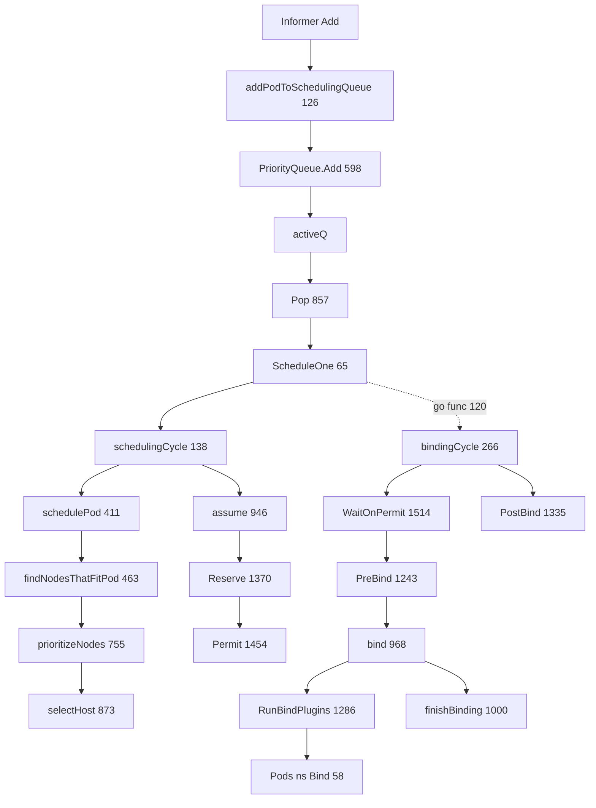

# kube-scheduler v1.32.0 源码学习总纲

> 用途：把 T1-1「追一个 Pod 的一生」的学习成果、失败矩阵、日志证据合并成一份可以脱离对话独立回顾的文档。
> 这版是 **v0.1 汇编稿**：只整理已经产出的结论，未过的 3 道复测题**不写答案**（见第 8.3 节）。

| 项 | 值 |
|---|---|
| 覆盖范围 | T1-1 主干（单 Pod 全流程）+ T0-1 / T0-2 的日志证据 |
| 源码版本 | kube-scheduler **v1.32.0** |
| 源码根 | 另一台机器：`D:\code\GoCode\src\scheduler\k8s-v1.32.0`；本机：仓库根（`.agents/source-root.local`），即 `pkg/scheduler/` |
| 注释 | 本机调度器全部 Go 源码（177 个文件，含测试）已汉化（行号不变） |
| 行号状态 | 2026-11-15 用模块缓存 `k8s.io/kubernetes@v1.32.0` 全量复核 |
| 合并来源 | `docs/T1-1-pod-lifecycle-6stages.md`、`docs/SCHEDULER_CALLCHAIN.md`、`docs/SCHEDULER_FAILURE_MATRIX.html`、`docs/SOURCE_SNAPSHOT.md`、`acceptance/` 两份记录、`progress.md` |
| 不覆盖 | Volcano / 大模型两条线；抢占内部算法；队列 backoff 与 QueueingHint 内部；DRA、volume 插件内部 |

---

## 目录

0. [怎么用这份文档](#0-怎么用这份文档)
1. [心智模型](#1-心智模型)
2. [六阶段总表](#2-六阶段总表)
3. [调用链逐段拆解](#3-调用链逐段拆解)
4. [三个必须讲清的机制](#4-三个必须讲清的机制)
5. [选节点内部：过滤、打分、选优](#5-选节点内部过滤打分选优)
6. [失败与回滚](#6-失败与回滚)
7. [日志视角](#7-日志视角)
8. [自测清单](#8-自测清单)
9. [盲区台账](#9-盲区台账)
10. [学习时间线](#10-学习时间线)
11. [行号速查与勘误](#11-行号速查与勘误)
12. [下一步](#12-下一步)

---

## 0. 怎么用这份文档

**三遍读法**

| 遍 | 读哪 | 目标 |
|---|---|---|
| 1 | 第 1–2 章 | 合上文档能说出 6 阶段顺序，不碰细节 |
| 2 | 第 3–6 章 + 打开源码 | 每个关键函数能说出：位置 / 职责 / 返回值给谁 / 失败分支 |
| 3 | 第 8 章自测 | 不看文档口述全链，答不出的记回盲区台账 |

**路径约定**

文中写法是 `pkg/scheduler/schedule_one.go:138`，即「相对源码根的文件路径 : 行号」。核对命令：

```bash
# 本机：仓库根就是源码根
export KS=$PWD/pkg/scheduler
# 另一台机器：export KS=D:/code/GoCode/src/scheduler/k8s-v1.32.0/pkg/scheduler

sed -n '138,263p' "$KS/schedule_one.go"      # schedulingCycle 全文
sed -n '946,963p'  "$KS/schedule_one.go"      # assume
```

**符号约定**

- ✅ 已通过 / 已澄清；🟡 模糊；🔴 误解；⬜ 空白
- 「账」= `assume` 在 cache 里做的乐观记账
- 「退账」= 把这笔账撤销（`RunReservePluginsUnreserve` + `Cache.ForgetPod`）

---

## 1. 心智模型

### 1.1 一句话

> Informer 把未绑定的 Pod 放进 activeQ；主循环取出一个 Pod，同步完成「选节点 → assume 记账 → Reserve → Permit」，然后交给一个独立的 goroutine 去写 apiserver。**选节点和记账是同步的，绑定是异步的。**

记忆抓手：**入队 → 出队 → 选节点 → 占坑 → 绑定 → 收尾**

### 1.2 两条时间线



### 1.3 三条不变量

1. **主调度循环只有一个 goroutine**：`scheduler.go:474` 用 `go wait.UntilWithContext(ctx, sched.ScheduleOne, 0)` 起了一个循环，但它自己内部是串行的。任何同步阶段的长阻塞都会让整个集群停摆。
2. **`RunXxx` 系列几乎没有算法**：它们只做「遍历插件列表 + 顺序/并行调度 + 记 metrics」。真正的判断都在插件里。
3. **决定节点 ≠ 记账 ≠ 集群可见**：三件事发生在三个不同时刻，见 1.4。

### 1.4 三个时间点（最容易混）

| 问题 | 时刻 | 代码 |
|---|---|---|
| 节点被**决定** | `selectHost` 返回 | `schedule_one.go:873`（调用点在 `:451`） |
| 调度器**内部认为**已属于该节点 | `assume` 写完 `NodeName` + cache | `schedule_one.go:946`，写字段在 `:951` |
| 集群**真正可见** | `Pods(ns).Bind()` 成功返回 | `default_binder.go:58` |

`FinishBinding`（`cache.go:376`）**不是**可见标志，也**不销账**，它只把 `bindingFinished` 置真、算 deadline。真正写 apiserver 的动作是 `default_binder.go:58`。

---

## 2. 六阶段总表

| 阶段 | 从哪到哪 | 一句话职责 | 这一段内嵌了什么 |
|---|---|---|---|
| 0 入队 | `eventhandlers.go:126` → `scheduling_queue.go:598` | Informer 收到未绑定 Pod，放进 activeQ | 无 |
| 1 出队 | `scheduler.go:464` → `schedule_one.go:65` → `Pop:857` | 循环取 Pod、选 Profile、跳过该跳的 | `frameworkForPod:379`、`skipPodSchedule:388`、`Done:863` |
| 2 选节点 | `schedulePod:411` → `findNodesThatFitPod:463` → `prioritizeNodes:755` → `selectHost:873` | 过滤出可行节点 → 打分 → 选最高 | PreFilter / Filter / PreScore / Score / Extender |
| 3 占坑 | `assume:946` → `Reserve:1370` → `Permit:1454` | cache 记账 + 插件级预留 + 放行判断 | `DeepCopy`、`AssumePod:361`、`waitingPods` |
| 4 绑定 | `go func:120` → `bindingCycle:266` → `bind:968` → `Pods.Bind:58` | 异步把 Binding 写进 apiserver | `WaitOnPermit:1514`、`PreBind:1243`、`RunBindPlugins:1286` |
| 5 收尾 | `finishBinding:1000` → `RunPostBindPlugins:1335` | 标记绑定结束 + 成功事件 | `FinishBinding:376`、`Queue.Activate:337` |

**每阶段的失败边界**

| 阶段 | 失败会发生什么 | 账要不要退 |
|---|---|---|
| 0–2 | 走同步失败出口，进 `FailureHandler` | 不需要（还没记账） |
| 3 | `assume` 失败不退；`Reserve` / `Permit` 失败就地退 | 记了才退 |
| 4 | 异步失败，统一进 `handleBindingCycleError` | 必须退 |
| 5 | 收尾不产生失败 | — |

---

## 3. 调用链逐段拆解

> 全链 36 个节点。每张表只回答三件事：**位置 / 职责 / 返回值给谁**。最后一列是读源码时容易踩的点。

### 3.0 阶段 0 · 入队

| 位置 | 职责 | 返回值 → 消费者 | 注意 |
|---|---|---|---|
| `eventhandlers.go:126 addPodToSchedulingQueue` | Informer 的 Pod add 回调，接收未绑定 Pod | 无；副作用 `SchedulingQueue.Add` | 日志在 `:132`，`V(3)` |
| `scheduling_queue.go:598 PriorityQueue.Add` | 包装成 `QueuedPodInfo` 放进 activeQ 并唤醒消费者 | 无 | 唤醒的是阻塞在 `Pop` 的主循环 |

**这一段和 cache 无关。** cache 回答「放不放得下」，队列回答「下一个轮到谁」。

### 3.1 阶段 1 · 出队

| 位置 | 职责 | 返回值 → 消费者 | 注意 |
|---|---|---|---|
| `scheduler.go:464 Run` | 启动队列（`:466`）、起循环（`:474`）、退出时 `Close` 队列并关插件（`:476-480`） | 无 | 不负责收集 Pod |
| `schedule_one.go:65 ScheduleOne` | 单个 Pod 的完整编排 | 无 | `:67` 取 Pod，`:103` 建 CycleState，`:114-115` 同步失败出口，`:120` 起 binding goroutine |
| `schedule_one.go:67 NextPod` | 阻塞出队 | `QueuedPodInfo` → `ScheduleOne` | 实现是 `podQueue.Pop`，赋值在 `scheduler.go:378` |
| `scheduling_queue.go:857 Pop` | 从 activeQ 取队头 | `QueuedPodInfo` → `ScheduleOne` | activeQ 空时阻塞 |
| `schedule_one.go:379 frameworkForPod` | 按 `schedulerName` 选 **Profile**（一套插件配置） | `Framework` → 后续所有插件调用 | 不是「选插件」 |
| `schedule_one.go:388 skipPodSchedule` | 跳过删除中 / 已 assume 的 Pod | `bool` → `ScheduleOne` | 跳过时不是重新入队 |
| `scheduling_queue.go:863 Done` | 清理 in-flight 记账 | 无 | QueueingHint 关闭时是空操作（`:864-868`），**不重入队也不出队** |

⚠️ **G1 高发区**：`NextPod` 是**出队**，不是入队。入队只有 `addPodToSchedulingQueue` → `PriorityQueue.Add` 这一条路。

### 3.2 阶段 2 · 选节点

这一阶段的边界是 `schedulePod` 到 `selectHost`。**PreFilter / Filter / PreScore / Score 全都嵌在这一阶段内部，不是独立阶段。**

#### 3.2.1 `schedulePod`（`schedule_one.go:411`）

| 行 | 动作 |
|---|---|
| `:414` | `Cache.UpdateSnapshot`：把 cache 增量同步进本轮只读快照 |
| `:423` | `findNodesThatFitPod`：过滤出可行节点 |
| `:429` | 可行节点为 0 → `FitError` |
| `:437-438` | **只剩 1 个可行节点 → 直接返回**，PreScore/Score 整体跳过 |
| `:446` | `prioritizeNodes`：打分 |
| `:451` | `selectHost`：选一个 |

`ScheduleResult` 的三个字段：`SuggestedHost`（给 `assume`）、`EvaluatedNodes` / `FeasibleNodes`（给日志和 metrics）。

#### 3.2.2 `findNodesThatFitPod`（`schedule_one.go:463`）

| 位置 | 职责 | 返回值 → 消费者 | 注意 |
|---|---|---|---|
| `:474 RunPreFilterPlugins`（`framework.go:709`） | 顺序跑 PreFilter，可缩小节点集 | `(PreFilterResult, Status, 不可调度插件集合)` → 本函数 | 失败直接短路 |
| `:494 evaluateNominatedNode`（实现 `:547`） | 有 `NominatedNodeName` 时先只验该节点 | `[]NodeInfo` → 本函数 | 抢占后下一轮优先验证 |
| `:516 findNodesThatPassFilters`（实现 `:591`） | 并行对候选节点跑 Filter | `[]NodeInfo` → 本函数 | 见 5.2 的提前停止 |
| `:525 findNodesThatPassExtenders`（实现 `:704`） | 串行跑 extender 的 Filter | `[]NodeInfo` → 本函数 | 扩展点外部实现 |

内层：

| 位置 | 职责 |
|---|---|
| `schedule_one.go:591 findNodesThatPassFilters` | 准备候选、控制并发、收集可行节点 |
| `schedule_one.go:676 numFeasibleNodesToFind` | 算「找到多少可行节点就停」（百分比，最少 100） |
| `framework.go:984 RunFilterPluginsWithNominatedPods` | 带 nominated Pod 的 Filter，必要时跑两轮 |
| `framework.go:872 RunFilterPlugins` | 遍历 Filter 插件组，遇错即停 |

#### 3.2.3 `prioritizeNodes`（`schedule_one.go:755`）

| 位置 | 职责 | 返回值 → 消费者 |
|---|---|---|
| `:778 RunPreScorePlugins`（`framework.go:1063`） | 生成打分阶段共享状态 | `Status` → `prioritizeNodes` |
| `:784 RunScorePlugins`（`framework.go:1112`） | 插件打分、归一化、乘权重、累加 | `[]NodePluginScores` → `prioritizeNodes` |
| `:816` extender `Prioritize` | 外部扩展器加权 | `prioritizedList` → `selectHost` |
| `:873 selectHost` | 取最高分并打散 | `host` → `ScheduleResult.SuggestedHost` |

`RunScorePlugins` 内部三步（细节见 5.3）：

1. `framework.go:1139` 按**节点**并行，每节点内顺序跑各插件（`:1145`）
2. `framework.go:1169` 按**插件**并行跑 `NormalizeScore`
3. `framework.go:1188-1212` 按节点并行，乘权重并累加 `TotalScore`

#### 3.2.4 `selectHost`（`schedule_one.go:873`）

堆取最高分；同分节点用蓄水池采样（`:895 rand.Intn(cntOfMaxScore) == 0`）打散。内部维护前 `count` 名列表，但 `schedulePod:451` 只用第一个返回值 `host`。

### 3.3 阶段 3 · 占坑

| 位置 | 职责 | 返回值 → 消费者 | 注意 |
|---|---|---|---|
| `schedule_one.go:946 assume` | 写 `Spec.NodeName`（`:951`）+ cache 记账（`:953`） | `error` → `schedulingCycle` | 改的是 `DeepCopy` 出来的 Pod |
| `cache.go:361 AssumePod` | 节点资源扣减、`podStates` 与 `assumedPods` 插入（`:441-443`） | `error` → `assume` | 已在 cache 里会直接报错（`:369-371`） |
| `framework.go:1370 RunReservePluginsReserve` | 插件级资源预留 | `Status` → `schedulingCycle` | 失败要 Undo |
| `framework.go:1454 RunPermitPlugins` | 插件放行判断；Wait 时只登记 `waitingPods`（`:1495`）并返回（`:1498`） | `Status` → `schedulingCycle` | **不阻塞主循环** |

这一阶段结束后，调度器「内部认为」Pod 已属于该节点，但 apiserver 还一无所知。

### 3.4 阶段 4 · 绑定（独立 goroutine）

| 位置 | 职责 | 返回值 → 消费者 | 注意 |
|---|---|---|---|
| `schedule_one.go:120 go func()` | 起 binding goroutine | — | `ScheduleOne` 不等待 |
| `schedule_one.go:266 bindingCycle` | 绑定周期编排 | `Status` → goroutine | 失败调 `handleBindingCycleError:129` |
| `:279 WaitOnPermit`（`framework.go:1514`） | **唯一真正阻塞的地方**，`<-waitingPod.s`（`:1525`） | `Status` → `bindingCycle` | 只阻塞这一个 goroutine |
| `:296 RunPreBindPlugins`（`framework.go:1243`） | 绑定前最后一次可拒绝的准备 | `Status` → `bindingCycle` | 典型是卷相关 |
| `:317 SchedulingQueue.Done` | PreBind 成功后就清理 in-flight | 无 | 之后的失败只算 Error |
| `:320 bind`（实现 `:968`） | 先 extender（`:974`），再走框架（`:978`）；`defer finishBinding`（`:970`） | `Status` → `bindingCycle` | 自身不直接发请求，HTTP 最终在插件侧 |
| `framework.go:1286 RunBindPlugins` | 遍历 Bind 插件，第一个非 Skip 的赢 | `Status` → `bind` | 一个都不处理时返回 Skip（`:1292`/`:1321`），`bindingCycle` 会按失败处理 |
| `default_binder.go:51 DefaultBinder.Bind` | 构造 `v1.Binding` | `Status` → `RunBindPlugins` | 日志在 `:53` |
| `default_binder.go:58 Pods(ns).Bind()` | **真正写 apiserver** | `error` → `DefaultBinder.Bind` | 这是内联调用，仓库里没有名为 `Pods.Bind` 的函数定义 |

### 3.5 阶段 5 · 收尾

| 位置 | 职责 | 注意 |
|---|---|---|
| `schedule_one.go:1000 finishBinding` | `defer` 总是执行 | 失败也跑 |
| `cache.go:376 FinishBinding` | 置 `bindingFinished`、按 ttl 算 `deadline`（`:392-400`） | **不销账** |
| `schedule_one.go:1009` | 成功时记录 `Scheduled / Successfully assigned` 事件 | 事件不是可见性标志 |
| `framework.go:1335 RunPostBindPlugins` | 绑定成功后的通知类回调 | 只在成功路径调用 |
| `schedule_one.go:336-338 Queue.Activate` | 激活 `podsToActivate` 里登记的 Pod | 来自 `PodsToActivateKey` |

---

## 4. 三个必须讲清的机制

### 4.1 队列 vs cache（G1，must-fix）

| 问题 | 谁回答 | 关键位置 |
|---|---|---|
| 下一个该调度谁 | SchedulingQueue（activeQ / backoffQ / unschedulablePods） | `scheduling_queue.go:598`、`:857` |
| 节点上现在有什么、还放得下吗 | Cache + 本轮 Snapshot | `cache.go:186`、`cache.go:361` |
| 这个 Pod 是不是被我乐观假设过 | `assumedPods` 集合 | `cache.go:67`、`:443` |

- Pod 在 `Pop`（`scheduling_queue.go:857`）时就已经离开 activeQ。
- `Done`（`:863`）只清 in-flight 记账，**不重入队也不出队**。
- `NewCycleState`（`schedule_one.go:103`）只是本次调度周期的空状态容器，与队列无关。
- 失败重排队发生在 `handleSchedulingFailure`（`schedule_one.go:1023`），不是 `Done`。

### 4.2 assume 的账本生命周期

**借**：`assume` → `AssumePod` → `addPod(assume=true)` → `assumedPods.Insert(key)`（`cache.go:443`）+ 节点资源账本。

**还**：三条路，最终都汇入 `removePod`（`cache.go:460`），末尾 `delete(assumedPods, key)`（`:481`）。

| 场景 | 入口 | 链 |
|---|---|---|
| 绑定成功（外部事实到达） | `eventhandlers.go:203 addPodToCache` | `Cache.AddPod`（`cache.go:485`）→ assumed 分支（`:496`）→ `updatePod`（`:449`）→ `removePod` → `addPod(false)` |
| 调度失败（主动退账） | `schedule_one.go:357-358` 或 `:210-211` / `:234-235` | `RunReservePluginsUnreserve` + `Cache.ForgetPod`（`cache.go:404`）→ `removePod` |
| Pod 被删除（外部事实删除） | `eventhandlers.go:282 deletePodFromCache` | `Cache.RemovePod`（`cache.go:546`）→ `removePod` |

**三个容易记反的细节**

1. `ForgetPod`（`cache.go:404`）**检查** `assumedPods`（`:418-422`），不是 assumed 就报 `wasn't assumed so cannot be forgotten`；`RemovePod`（`:546`）**不检查**，直接删。这个不对称是有意的：前者是调度器主动退账，后者是外部事实。
2. 绑定成功后 informer 送来的其实是 **MODIFIED**，但 `FilteringResourceEventHandler.OnUpdate`（client-go `tools/cache/controller.go:313-326`）会把「过滤前 false → 过滤后 true」的更新**转译成 OnAdd**。这就是 assumed Pod 能收到 Add 事件的原因（见 `cache.go:532-533` 注释）。
3. `cleanupAssumedPods`（`cache.go:730`）默认**不生效**：`durationToExpireAssumedPod = 0`（`scheduler.go:58`），于是 `FinishBinding` 把 `deadline` 置 nil（`:393-394`），`:746` 的 `ttl != 0` 永远不成立。**`FinishBinding` 总是执行，失效的是 TTL 清理，不是它。**

**口诀：账记上了才要退；退账两条动作，缺一不可。**

### 4.3 同步 / 异步边界

| 问题 | 同步阶段（`schedulingCycle`） | 异步阶段（`bindingCycle`） |
|---|---|---|
| 跑在哪 | 主循环 goroutine | `schedule_one.go:120` 起的子 goroutine |
| 覆盖扩展点 | PreFilter → Filter → PreScore → Score → Reserve → Permit | WaitOnPermit → PreBind → Bind → PostBind |
| 能否阻塞主循环 | 能，必须短 | 不能，阻塞只影响这个 Pod |
| 失败处理 | `FailureHandler`（`:115`） | `handleBindingCycleError`（`:129`）→ 再进 `FailureHandler` |

**为什么要拆**

1. 绑定是远程 I/O，同步做会阻塞**唯一**的主调度循环（`scheduler.go:474`）。
2. `Permit` 可能返回 Wait（gang / 外部审批），不能占着主循环干等。

**Permit 的真实行为**

- `RunPermitPlugins` 返回 Wait 时**不阻塞**，只把 waiting pod 塞进 `f.waitingPods`（`framework.go:1495`）并返回 Wait（`:1498`）。
- `schedulingCycle:232` 判断的是 `!IsWait() && !IsSuccess()` —— **Wait 与 Success 同等对待**，直接进入绑定周期。
- 真正的阻塞发生在 binding goroutine 的 `WaitOnPermit`（`framework.go:1514`，阻塞行 `:1525`）。

代价是引入了 optimistic concurrency：**先占坑 → 后落地 → 失败退账**。

---

## 5. 选节点内部：过滤、打分、选优

### 5.1 过滤

`findNodesThatFitPod` 的顺序固定：

1. `RunPreFilterPlugins`（`framework.go:709`）：顺序执行；返回的 `PreFilterResult` 可以缩小节点集。
2. 有 `NominatedNodeName` 时先试提名节点（`evaluateNominatedNode:547`）。
3. `findNodesThatPassFilters`（`:591`）：对候选节点并行跑 Filter。
4. `findNodesThatPassExtenders`（`:704`）：串行跑外部 extender。

`RunFilterPluginsWithNominatedPods`（`framework.go:984`）会在节点上临时加入 nominated Pod 再跑第二遍 Filter，用于模拟「高优先级 Pod 让位后」的结果；第一遍失败就不跑第二遍（`:1018-1022`）。

### 5.2 并行与提前停止

- `findNodesThatPassFilters:617` 建可取消 ctx；`:625` 的 `checkNode` 每找到可行节点就原子加一。
- 达到 `numNodesToFind`（`:599`）时 `cancel()`（`:637`），`Parallelizer.Until`（`:658`）停止派发新任务。
- 提前停止是安全的：够打分的样本数就够，不需要全量。

### 5.3 打分流水线（`framework.go:1112`）

```
按节点并行（:1139）
  └ 每个节点内，按插件顺序跑 Score（:1145-1161）
        ↓ 写入 pluginToNodeScores[plugin][node]
按插件并行跑 NormalizeScore（:1169-1181）  ← 把不同量纲压到 0-100
按节点并行，乘权重并累加（:1188-1212）
        TotalScore += score * weight
        ↓
[]NodePluginScores 交给 selectHost
```

- 归一化在 `NormalizeScore`，权重在 `scorePluginWeight`（`:1195`），乘完累加（`:1204-1209`）。
- 归一化后仍越界会直接报错（`:1199-1203`）。
- **注意方向**：Score 是「按节点并行、节点内串行跑插件」；NormalizeScore 才是「按插件并行」。不要记反。

### 5.4 选优与打散

`selectHost:873`：

- 先按总分建堆，取最高分。
- 同分节点用蓄水池采样（`:895`）随机选一个，避免所有 Pod 都压到同名列第一的节点。
- 内部维护前 `count` 名列表（调用方传 `numberOfHighestScoredNodesToReport`，即 3），但 `schedulePod:451` 只用第一个返回值 `host`，后两个被丢弃。

### 5.5 两个日志现象的解释

1. **单节点集群调度只花 0.5ms**：`schedule_one.go:438` 的 `len(feasibleNodes) == 1` 直接返回，PreScore/Score 整体跳过。
2. **`--v=10` 看不到 `Plugin scored node for pod`**：这条日志在 `schedule_one.go:794`，前提是走到了 `prioritizeNodes`。只有一个可行节点时根本不会走到。想看插件打分，至少要有两个可行节点。

---

## 6. 失败与回滚

### 6.1 分界线

| 路径 | 判定位置 | 处理函数 | 此时 cache 状态 |
|---|---|---|---|
| 同步失败 | `schedule_one.go:114` | `FailureHandler` = `handleSchedulingFailure`（`:1023`） | 可能还没 assume，也可能已 assume |
| 异步失败 | `schedule_one.go:128` | `handleBindingCycleError`（`:345`） | **一定**已 assume + 已 Reserve |

### 6.2 同步失败：7 个出口（全部在 `schedulingCycle` 内）

| # | 触发点 | 位置 | Status | 退账 |
|---|---|---|---|---|
| 1 | `SchedulePod` 返回 `ErrNoNodesAvailable` | `:153-156` | `UnschedulableAndUnresolvable` | 无 |
| 2 | `SchedulePod` 返回非 `FitError` | `:158-161` | `Error` | 无 |
| 3 | `FitError` 且无 PostFilter 插件 | `:169-171` | `Unschedulable` | 无 |
| 4 | `FitError` 且有 PostFilter 插件（走抢占） | `:175-188` | `Unschedulable` | 无 |
| 5 | `assume` 失败 | `:197-205` | `Error` | 无 |
| 6 | `Reserve` 失败 | `:208-228` | Rejected → `FitError`，否则原样 | `Unreserve`（`:210`）+ `ForgetPod`（`:211`） |
| 7 | `Permit` 失败（非 Wait 非 Success） | `:232-253` | 同上 | `Unreserve`（`:234`）+ `ForgetPod`（`:235`） |

出口 6、7 是**就地退账**，所以 `FailureHandler` 只负责重排队、记事件、写 Pod condition，不再碰 cache。

### 6.3 异步失败：3 个出口（全部在 `bindingCycle` 内）

| # | 触发点 | 位置 | 典型原因 |
|---|---|---|---|
| 1 | `WaitOnPermit` 失败 | `:279` | Permit 等待期间被 Reject 或插件超时 |
| 2 | `RunPreBindPlugins` 失败 | `:296` | 卷挂载 / 参数准备 |
| 3 | `bind` 失败 | `:320` | extender Bind 失败；`Pods.Bind` HTTP 失败（`default_binder.go:58`） |

`SchedulingQueue.Done` 在 PreBind 成功后（`:317`）就调用，因为之后的失败只算 Error，不再判 Unschedulable。

### 6.4 `handleBindingCycleError` 的兜底四步（`schedule_one.go:345`）

| 步 | 动作 | 位置 | 作用 |
|---|---|---|---|
| ① | `RunReservePluginsUnreserve` | `:357`；实现 `framework.go:1414`，逆序 `:1427` | 逆序撤销插件资源预留 |
| ② | `Cache.ForgetPod` | `:358`；实现 `cache.go:404` | 摘 Pod、删 `podStates` / `assumedPods`、恢复资源账本 |
| ③ | `MoveAllToActiveOrBackoffQueue` | `:368-372`；实现 `scheduling_queue.go:1056` | 发 `EventAssignedPodDelete`，唤醒被挡住的 Pod |
| ④ | `FailureHandler` | `:376` | 记事件、写 condition、重排队、`Done` 兜底（`handleSchedulingFailure:1030`） |

`ForgetPod` 失败只打日志（`:359`），流程继续；默认 `ttl=0` 时没有 TTL 兜底（见 4.2），残账只能靠后续 informer 事件或重启清理。

### 6.5 rejected 与 error 两种语义

`IsRejected()` 的定义：`Unschedulable`、`UnschedulableAndUnresolvable`、`Pending` 三者之一（`framework/interface.go:369-372`）。

| 维度 | `IsRejected() == true` | `IsRejected() == false`（通常 `Error`） |
|---|---|---|
| 含义 | Pod 本身不适合当前集群状态 | 环境 / 网络 / 插件故障 |
| Pod condition reason | `Unschedulable` | `SchedulerError`（`schedule_one.go:1035-1037`） |
| 重排队路径（QueueingHint 关闭） | 有 rejectorPlugins：通常进 `unschedulablePods`；若期间收到 move request 则进 `backoffQ` | 无 rejectorPlugins：直接进 `backoffQ`，尽快重试 |
| 依据 | `scheduling_queue.go:732-745` | 同左 |

### 6.6 同步 vs 异步对照

| 维度 | 同步失败 | 异步失败 |
|---|---|---|
| 判定 | `ScheduleOne:114` | `ScheduleOne:128` |
| 处理 | `handleSchedulingFailure`（`:1023`） | `handleBindingCycleError`（`:345`）→ 再进 `handleSchedulingFailure` |
| 是否已 assume | 可能没有 | 一定有 |
| 退账位置 | Reserve / Permit 分支内联（`:210-211`、`:234-235`） | 统一在 `handleBindingCycleError` |
| `ClusterEvent` | 不发 | 发 `EventAssignedPodDelete`（调度器内部事件，不是 k8s Event） |
| nominatedInfo | 保留（抢占可能刚产生） | 丢弃（`clearNominatedNode`） |

### 6.7 退账速查

| 出口 | 退账动作 | Status |
|---|---|---|
| 选节点阶段任何失败 | 无 | `Unschedulable` / `Error` |
| `assume` 失败 | **无** | `Error` |
| `Reserve` 失败 | `Unreserve` + `ForgetPod` | Rejected → `FitError` |
| `Permit` 失败 | `Unreserve` + `ForgetPod` | Rejected → `FitError` |
| 异步任何失败 | `Unreserve` + `ForgetPod` + 唤醒队列 | 原 status（可能 Rejected，也可能 Error） |

**口诀：账记上了才要退。**

### 6.8 易踩的坑

1. `ForgetPod` 失败只打日志（`:358-359`），流程继续，可能留下残账；默认 `ttl=0`，没有兜底清理。
2. Reserve 失败不会退两次：同步分支内联退账，`FailureHandler` 不碰 cache。
3. `Unreserve` 撤销的是插件资源预留；`assume` 的撤销永远是 `ForgetPod`，层次不同。
4. 成功路径不经过 `handleBindingCycleError`；`RunPostBindPlugins` 只在成功时调用。
5. `FinishBinding` 与 `cleanupAssumedPods` 是两个独立开关：前者总是执行，后者默认不生效。

---

## 7. 日志视角

### 7.1 环境

- kind 集群 `wpk8s`，单 control-plane，Kubernetes v1.32.0
- kube-scheduler 启动参数：`--v=5 --leader-elect=true`
- 日志时区 UTC（比本机 CST 慢 8 小时）
- 证据文件：`logs/03`、`04`、`08`，说明见 `logs/README.md`

### 7.2 日志行 → 源码

| 日志位置 | 级别 | 消息 | 对应源码 |
|---|---|---|---|
| `eventhandlers.go:132` | V(3) | `Add event for unscheduled pod` | `addPodToSchedulingQueue`（`:126`） |
| `eventhandlers.go:186` | V(3) | `Delete event for unscheduled pod` | `deletePodFromSchedulingQueue`（`:165`） |
| `eventhandlers.go:214` | V(3) | `Add event for scheduled pod` | `addPodToCache`（`:203`） |
| `eventhandlers.go:251` | V(4) | `Update event for scheduled pod` | `updatePodInCache` |
| `scheduling_queue.go:587` | V(5) | `Pod moved to an internal scheduling queue` | 队列搬移 |
| `schedule_one.go:83` | V(4) | `About to try and schedule pod` | `ScheduleOne` |
| `schedule_one.go:99` | V(3) | `Attempting to schedule pod` | `schedulingCycle` 前 |
| `default_binder.go:53` | V(3) | `Attempting to bind pod to node` | `DefaultBinder.Bind` |
| `cache.go:390` | V(5) | `Finished binding for pod, can be expired` | `finishBinding` |
| `schedule_one.go:325` | V(2) | `Successfully bound pod to node` | `bindingCycle` 成功 |
| `framework.go:399` | V(2) | `the scheduler starts to work with those plugins` | Profile 初始化 |

### 7.3 单节点为什么看不到打分

`schedule_one.go:437-443`：只有一个可行节点时直接返回。日志会从 `Attempting to schedule` 直接跳到 `Attempting to bind`。这不是丢日志，是 PreScore/Score 被整段跳过。

### 7.4 插件打分日志

`schedule_one.go:790-797`（打印在 `:794`）只在 V(10) 且走到 `prioritizeNodes` 时输出。验证方法：至少两个可行节点 + `--v=10`。

### 7.5 `FailedScheduling` 那句话是谁拼的（补查结论）

> 本次整理时顺带补查，可直接用来收口 T0-2 的交付物。

| 环节 | 位置 |
|---|---|
| 格式常量 `"0/%v nodes are available"` | `pkg/scheduler/framework/types.go:520` |
| 拼完整消息 `0/X nodes are available: ...` | `FitError.Error()`，`types.go:543-593` |
| 按原因聚合节点数（`3 Insufficient cpu, ...`） | `types.go:560-582` |
| 写 Pod condition + 发 `FailedScheduling` 事件 | `schedule_one.go:1098-1099`、`:1100-1105` |
| 截断超长消息 | `truncateMessage`，`schedule_one.go:1111-1118` |

**为什么 events 只有一句话、日志里细节更多**：events 只有一个 `message` 字段，且会被截断；调度器在 V(5)/V(4) 日志里还分别记录了每个节点的 Filter 结果、每个插件的状态。排查时先看 events 定位原因类别，再看日志定位具体节点/插件。

---

## 8. 自测清单

### 8.1 粗颗粒 6 阶段（2026-11-12 已通过）

合上文档，用自己的话回答：

- [ ] 6 个阶段的顺序和每段一句话职责
- [ ] Pod 是谁、在哪一步放进 activeQ 的？
- [ ] 「节点被决定」「内部认为已定」「集群可见」分别在哪个函数之后？
- [ ] 为什么要把绑定放到另一个 goroutine？
- [ ] `Permit` 返回 Wait 时，主循环会停下来等吗？

### 8.2 细颗粒 12 步

| 步 | 跳转 | 自问 | 状态 |
|---|---|---|---|
| 1 | `schedule_one.go:65` | 编排做了哪几件事？两个失败出口分别在哪？ | ✅ 已通过 |
| 2 | `schedule_one.go:138` | 失败后谁负责回滚？ | 🔄 进行中（3 题待答） |
| 3 | `schedule_one.go:411` | 只有一个可行节点时哪一行提前返回、跳过了什么？ | ⬜ |
| 4 | `schedule_one.go:463` | PreFilter 的 Status 有几种流向？ | ⬜ |
| 5 | `framework.go:709` | `PreFilterResult` 如何缩小节点集？ | ⬜ |
| 6 | `schedule_one.go:591` | 为什么「找到一个就 cancel」是安全的？ | ⬜ |
| 7 | `framework.go:984` | 提名 Pod 为什么要跑两轮 Filter？ | ⬜ |
| 8 | `schedule_one.go:755` | TotalScore 怎么累加？ | ⬜ |
| 9 | `framework.go:1112` | Score 和 NormalizeScore 的并发粒度为什么不同？ | ⬜ |
| 10 | `schedule_one.go:873` | 同分节点为什么打散？ | ⬜ |
| 11 | `schedule_one.go:946` + `cache.go:361` | `assume` 改了什么？为什么 bind 没成功就记账？ | ⬜ |
| 12 | `schedule_one.go:968` → `default_binder.go:51` | 失败时谁清理 assumed 状态？ | ⬜ |

### 8.3 本轮待答 3 题（答案不写在这里）

> 按验收规则，答完再回填结论；现在看答案等于跳过练习。

1. `assume` 失败时为什么不调 `ForgetPod`？硬要调会撞上哪一行、报什么错？
2. `Reserve` 失败与 `Permit` 失败的退账动作完全相同吗？说出两个函数名。
3. 为什么需要 `podInfo.DeepCopy()`？直接改写原对象，失败重入队时会怎样？

答题提示（不给答案）：第 1 题从 `AssumePod` 的入口检查看起；第 2 题看两个分支的 3 行代码；第 3 题看 `assumedPodInfo` 从哪来、`assume` 改了它哪个字段、队列里存的又是哪份对象。

### 8.4 终检标准

不看任何文档，3–5 分钟口述：

- 6 阶段顺序 + 每段职责
- 每个关键函数的输入 / 输出 / 失败分支
- 三个时间点
- 两条退账路径和「账记上了才要退」
- 为什么同步/异步要拆

---

## 9. 盲区台账

| 编号 | 盲区 | 状态 |
|---|---|---|
| G1 | 把 `NextPod` 当「入队」；cache 与 queue 混用 | **open · must-fix**（出现 ≥2 次） |
| G2 | 选节点整段缺失（`ScheduleOne` 后直接跳到 `assume`） | open |
| G3 | 把 `handleBindingCycleError` 当主干 | open |
| G4 | 把 `NewCycleState` 当 PreFilter / 认为它让 Pod 进 activeQ | open |
| G5 | 不清楚 `SchedulingQueue.Done` 的语义 | open |
| G6 | 失败出口函数名说错 | open |
| G7 | 不理解 `FailureHandler` / `SchedulePod` 是函数字段 | fixed |
| G8 | 认为 `Scheduler.Run` 负责收集待调度 Pod | fixed |
| G9 | 阶段 3 跳过 Reserve / Permit | fixed |
| G10 | 认为拆分绑定周期是为了避免「绑定失败却写入」 | fixed |
| G11 | 把 `FinishBinding` 当成「集群可见」标志 | fixed |
| G12 | PreFilter / Score 被当成独立阶段 | fixed |
| G13 | 误以为 `assume` 失败后要 `ForgetPod` | **open · 🔴** |
| G14 | 误以为 `Permit` 失败不退账（与 `assume` 弄反） | **open · 🔴** |
| G15 | 不知道 `DeepCopy` 的必要性 | open · ⬜ |

---

## 10. 学习时间线

| 日期 | 发生了什么 |
|---|---|
| 2026-11-07 | 首次验收 T1-1；发现 G1–G7，函数字段机制 A/B 过关 |
| 2026-11-09 | 粒度改为「先粗后细」；产出 6 阶段主干；仓库扩成 33 张卡 |
| 2026-11-10 | 三个核心文件注释汉化；第 4 节复测 3 题未过，追 1/追 2 随后补齐 G9/G10 |
| 2026-11-12 | 第 3 次重测 A/B/C 全过；**粗颗粒 6 阶段层通过**；G11/G12 关闭；产出 `docs/T1-1-pod-lifecycle-6stages.md` |
| 2026-11-13 | 开细颗粒第 2 步（`schedulingCycle`）；`assume` / `Permit` 退账两处说反，新增 G13/G14；`DeepCopy` 未知记 G15 |
| 2026-11-15 | 重新拉取干净 v1.32.0；整理本汇编稿，全量核对行号并修正旧引用 |

---

## 11. 行号速查与勘误

### 11.1 一页速查

```
入队  eventhandlers.go:126 → scheduling_queue.go:598
出队  scheduler.go:464 (Run) → schedule_one.go:65 (ScheduleOne)
      → :67 NextPod → scheduling_queue.go:857 (Pop)
选节点 schedule_one.go:411 (schedulePod)
      ├ :414 UpdateSnapshot (cache.go:186)
      ├ :423 findNodesThatFitPod (:463)
      │   ├ :474 RunPreFilterPlugins (framework.go:709)
      │   ├ :494 evaluateNominatedNode (:547)
      │   ├ :516 findNodesThatPassFilters (:591)
      │   └ :525 findNodesThatPassExtenders (:704)
      ├ :438 单节点直接返回
      ├ :446 prioritizeNodes (:755) → PreScore framework.go:1063
      │                               Score    framework.go:1112
      └ :451 selectHost (:873)
占坑  :946 assume → cache.go:361 (AssumePod)
      framework.go:1370 Reserve
      framework.go:1454 Permit（Wait 只登记 waitingPods:1495）
绑定  :120 go func → :266 bindingCycle
      → :279 WaitOnPermit (framework.go:1514, 阻塞 :1525)
      → :296 PreBind (framework.go:1243)
      → :317 Done
      → :320 bind (:968) → :974 extender / :978 RunBindPlugins (framework.go:1286)
                                  → default_binder.go:51 → :58 Pods.Bind  ← 集群可见
收尾  :1000 finishBinding → cache.go:376 FinishBinding
      :333 RunPostBindPlugins (framework.go:1335)
失败  :115 FailureHandler → :1023 handleSchedulingFailure
      :129 handleBindingCycleError (:345)
```

### 11.2 勘误表（旧文档与本稿不一致处以本稿为准）

| 旧写法 | 实际 | 说明 |
|---|---|---|
| `go func` 在 `schedule_one.go:121` | **`:120`** | `:121` 是 `context.WithCancel` |
| `handleSchedulingFailure` 在 `:1053` | **`:1023`** | `progress.md`、`acceptance/T1-1` 里的旧值；`:1053` 是函数体内的 `FitError` 分支 |
| 单节点短路在 `:437` | **`:438`** | `:437` 是注释，判断在 `:438` |
| `addPodToCache` 在 `eventhandlers.go:215` | 函数 **`:203`** | `:215` 是内部的 `Cache.AddPod` 调用 |
| `RunReservePluginsUnreserve` 在 `framework.go:1298` | **`:1414`** | `acceptance/2026-11-07` 旧值 |
| `WaitOnPermit` 1514 vs 1525 | 两者都对 | `:1514` 是函数，`:1525` 是阻塞行 |
| 打分「按插件并发」 | Score 按**节点**并行（`:1139`），NormalizeScore 按**插件**并行（`:1169`） | `plan/daily-plan.md` 的提法需要修正 |

> 旧文档里其余行号（`cache.go`、`scheduling_queue.go`、`framework.go` 的扩展点、`default_binder.go`）本次复核全部一致。

---

## 12. 下一步

1. 先答完 8.3 的 3 题；通过后把结论回填到本节，并关闭 G13/G14/G15。
2. 进细颗粒第 3 步：`schedule_one.go:411` 的 `schedulePod`，重点是 3 个返回值和 `:438` 的提前返回。
3. 12 步走完后做终检口述；G1 用「队列回答下一个是谁，cache 回答放不放得下」这句话反复复述。
4. 终检通过后再进 T2-0（编译 kube-scheduler）。

> 恢复入口：新会话读 `progress.md` 的「下次入口」，再读本文件 8.3 与 12 节。
