# T1-1 流程图填空练习（自己填细节）

> 用途：不看书，先把图里的 `填「...」` 补上，再对照答案。图只是骨架，细节由你填。
> 规则：每个空都按「输入 / 输出 / 失败谁处理」三样写；填不出就写「断了」，不要猜。
> 对照答案：`docs/SCHEDULER_STUDY_GUIDE.md`、`docs/review-2026-11-18.md`、`docs/SCHEDULER_CALLCHAIN.md`。

- 当前进度：第 5 步 `RunPreFilterPlugins`（第 4 步已通过）
- 最近整理：2026-11-22

## 目录

- 图 1：主干 6 阶段
- 图 2：ScheduleOne 同步 / 异步
- 图 3：schedulePod 四个短路口
- 图 4：PreFilter / Filter / PostFilter
- 图 5：第 4 步 findNodesThatFitPod
- 图 6：第 5 步 RunPreFilterPlugins
- 填空表
- 自查清单
- 用法
- 怎么改图

## 图 1：主干 6 阶段（粗颗粒）

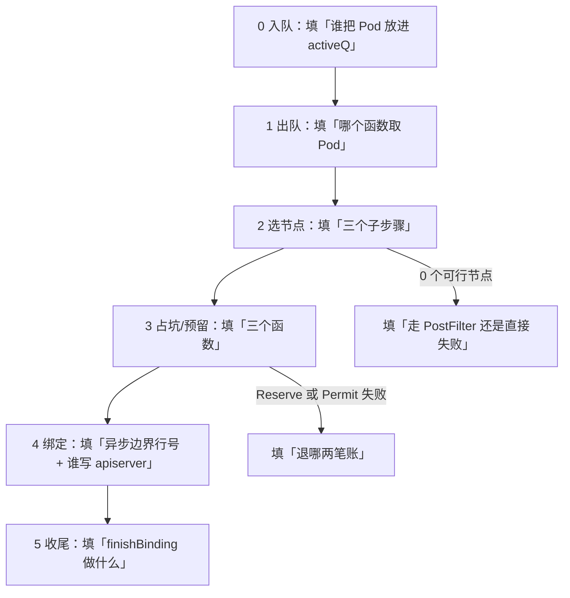

## 图 2：`ScheduleOne` 的同步 / 异步分叉

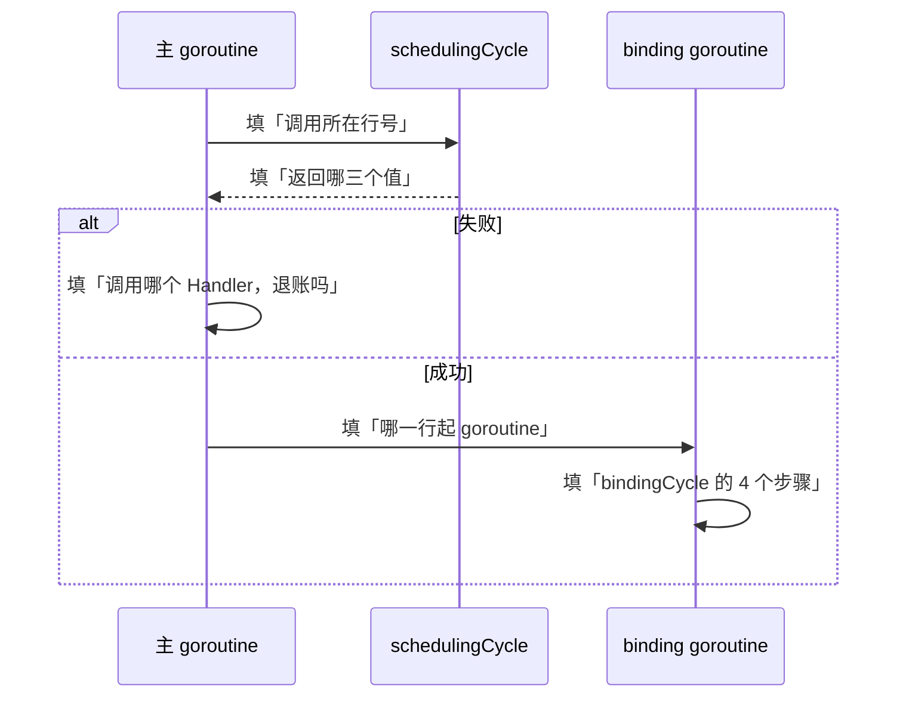

## 图 3：`schedulePod` 的四个短路口（重点）

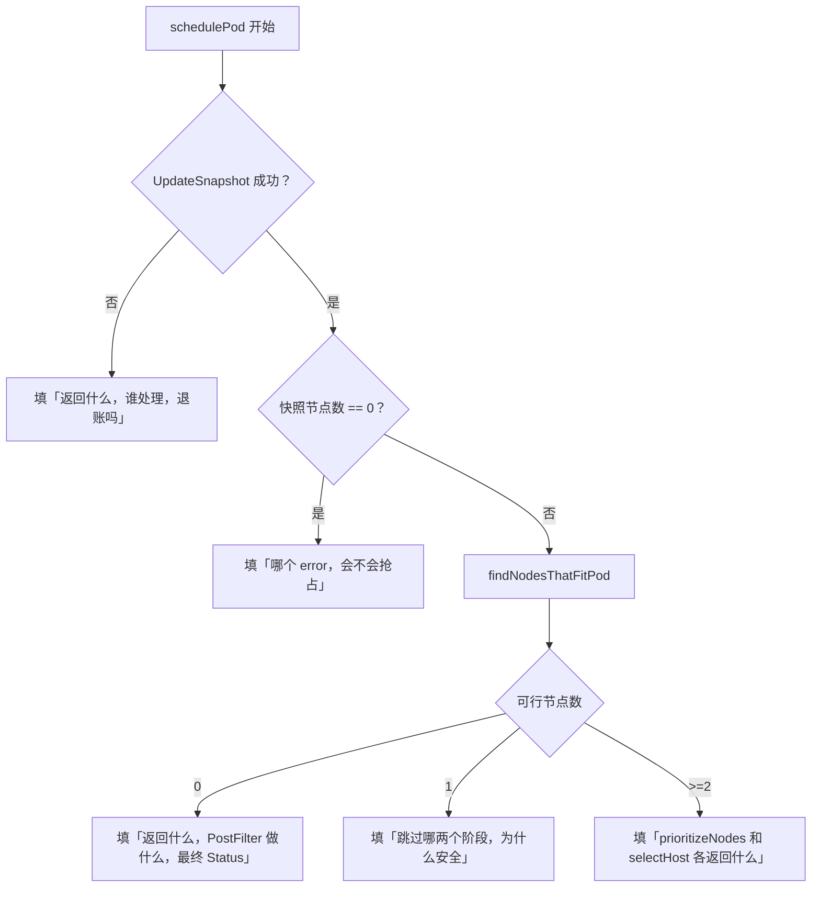

## 图 4：PreFilter / Filter / PostFilter

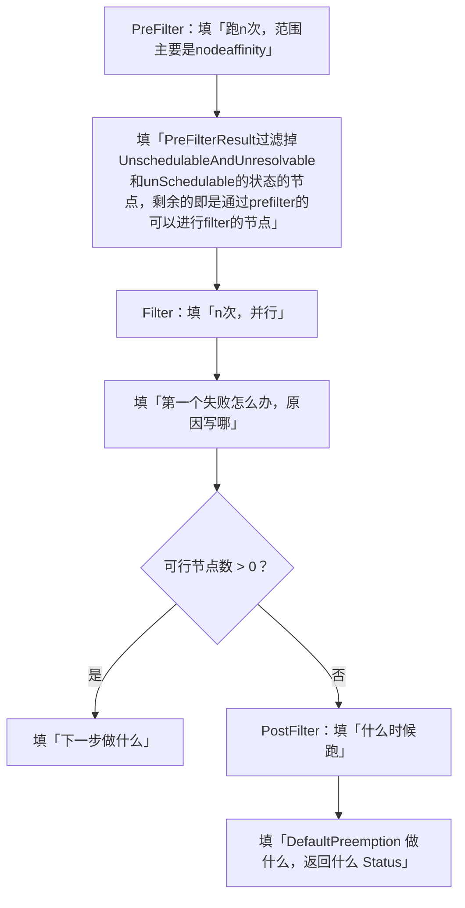

### 图 4 校对

- PreFilter **跑 1 次**（不是 n 次）；它先于节点遍历。
- `PreFilterResult.NodeNames` 缩小的是**候选节点集**，不是「过滤状态」；被排除的节点标成 `UnschedulableAndUnresolvable`。
- Filter 才是逐节点、并行。

## 图 5：第 4 步 `findNodesThatFitPod`（已完成）

### 5-1 主流程与 PreFilter 的三种 Status

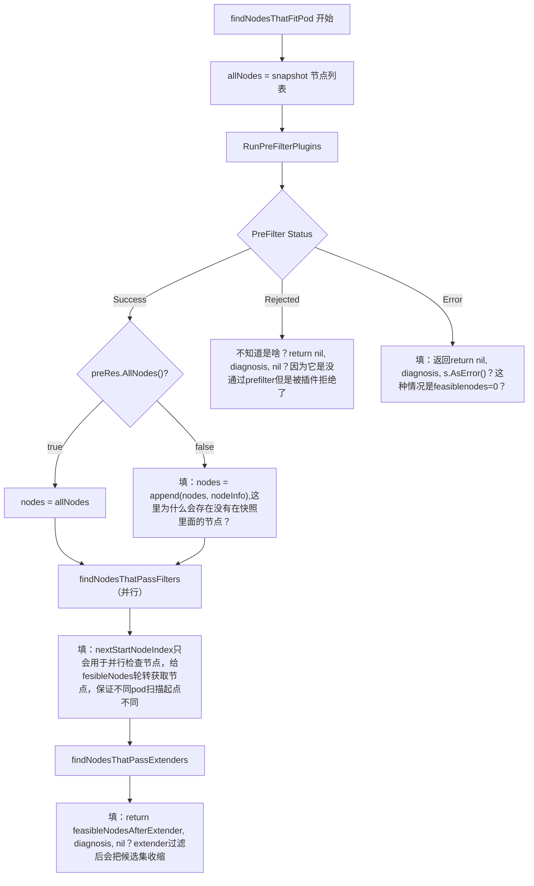
PS：
假设候选节点 1000 个，本轮只需要找 100 个可行节点：
第一轮：第 1 个 Pod 0 ~ 99 100（游标位置）
第二轮：第 2 个 Pod 100 ~ 199 200

为什么需要这样
因为 Filter 是提前停止的：找到足够多的可行节点后就不再继续扫描。
如果每个 Pod 都从 0 开始扫，那么排在后面的节点可能永远轮不到被检查，导致节点利用率不均。游标轮转让扫描窗口在不同 Pod 之间错开，长期看每个节点都有机会被检查。

### 5-1 校对（你填的三处）

1. **Rejected 分支**：完整动作是 `SetAbsentNodesStatus(s)` + `PreFilterMsg = s.Message()` + `AddPluginStatus(s)`，然后 `return nil, diagnosis, nil`。不返回 error，是因为「拒绝」是正常的不可调度，不是故障；下游才能生成 `FitError` 并跑 PostFilter。
2. **Error 分支**：返回 `s.AsError()` 对，但**不是「feasibleNodes=0」**。它是插件执行出错，`schedulePod` 把 error 往上抛，`schedulingCycle` 走 `AsStatus` → Error，**不会抢占**。
3. **NodeNames 里为什么会有快照中不存在的节点**：`PreFilterResult` 是插件算出来的，可能包含已删除/过期/拼错的节点名；`snapshot.Get` 失败就跳过，剩下的节点统一标成 `UnschedulableAndUnresolvable`。

### 5-2 `NominatedNodeName` 提前返回

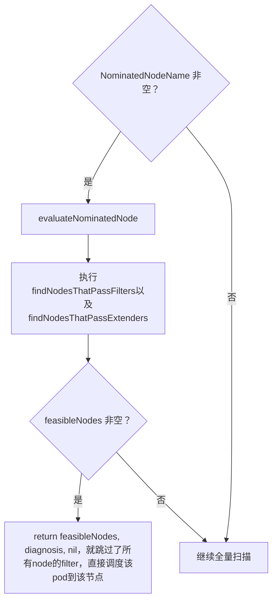

### 5-3 `Diagnosis` 的五个字段

> `Diagnosis` 是跨阶段的共享失败账本：PreFilter / Filter / Extender / Reserve·Permit / PostFilter 都往里写，最后由 `FitError.Error()` 汇总成事件。

| 字段 | 谁写 | 什么时候写 | 谁读 |
|---|---|---|---|
| `NodeToStatus` | PreFilter / Filter / Extender / Reserve·Permit / bindingCycle | 节点或整批节点被拒时 | `FitError.Error()`、`DefaultPreemption`、`EvaluatedNodes` |
| `UnschedulablePlugins` | PreFilter 返回值 / `AddPluginStatus` / Extender | 插件返回 `Unschedulable` / `Unresolvable` 时 | `handleSchedulingFailure` → `podInfo` → 队列重试 |
| `PendingPlugins` | `AddPluginStatus` | 插件返回 `Pending` 时 | 同上 |
| `PreFilterMsg` | `findNodesThatFitPod` | PreFilter 拒绝 Pod 时 | `FitError.Error()` |
| `PostFilterMsg` | `schedulingCycle` | PostFilter 跑完后 | `FitError.Error()` |

#### 具体写入点

**`NodeToStatus`**（指针，按值传 `Diagnosis` 时 map 仍共享）：

- PreFilter 拒绝：`SetAbsentNodesStatus(s)`（`schedule_one.go:481`）
- PreFilterResult 缩小节点集：被排除的节点标成 `UnschedulableAndUnresolvable`（`:514`）
- Filter 逐节点拒绝：`Set(item.node, item.status)`（`:664`）
- Extender 拒绝：`:734`
- Reserve / Permit 单节点失败：`:223`、`:247`
- bindingCycle 的 WaitOnPermit / PreBind 失败：`:289`、`:306`

**`UnschedulablePlugins`**：

- PreFilter 直接赋值：`diagnosis.UnschedulablePlugins = unscheduledPlugins`（`:475`）
- `AddPluginStatus` 从 Status 取插件名（`framework/types.go:527-531`）
- Extender 过滤掉节点后补 `framework.ExtenderName`（`:538-541`）

**`PendingPlugins`**：

- 只有 `AddPluginStatus` 在 `Code() == Pending` 时写（`framework/types.go:533-537`）

**`PreFilterMsg` / `PostFilterMsg`**：

- `PreFilterMsg`：PreFilter 拒绝时写一次（`:485`）
- `PostFilterMsg`：PostFilter 跑完后写一次（`:177`）

#### 为什么要分这么多字段

因为消费者不同：

- `PreFilterMsg` + `NodeToStatus` + `PostFilterMsg` → 给 `FitError.Error()` 拼 `FailedScheduling` 事件；
- `UnschedulablePlugins` / `PendingPlugins` → 给队列用，决定 Pod 什么时候被重新唤醒；
- `NodeToStatus` → 还给抢占用，`UnschedulableAndUnresolvable` 的节点不会被选去抢占。

一句话：**`Diagnosis` 是给三个下游（事件、队列、抢占）共用的一份失败记录。**

### 第 4 步要填的 4 个空

1. PreFilter `Rejected` 分支：Diagnosis 怎么记、返回什么、为什么不是 error？
2. PreFilter `Error` 分支：返回什么、谁处理？
3. `preRes.NodeNames` 怎么构造 `nodes`？缺失节点和排除节点怎么标？
4. `nextStartNodeIndex` 怎么更新？为什么出错也更新？

## 图 6：第 5 步 `RunPreFilterPlugins`（当前）

### 6-1 主循环与三种 Status

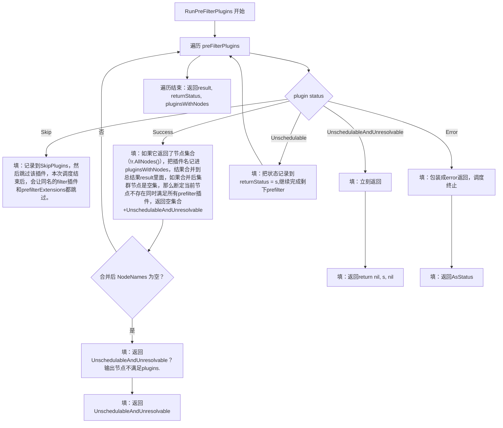

### 6-2 `PreFilterResult.Merge` 的四种组合

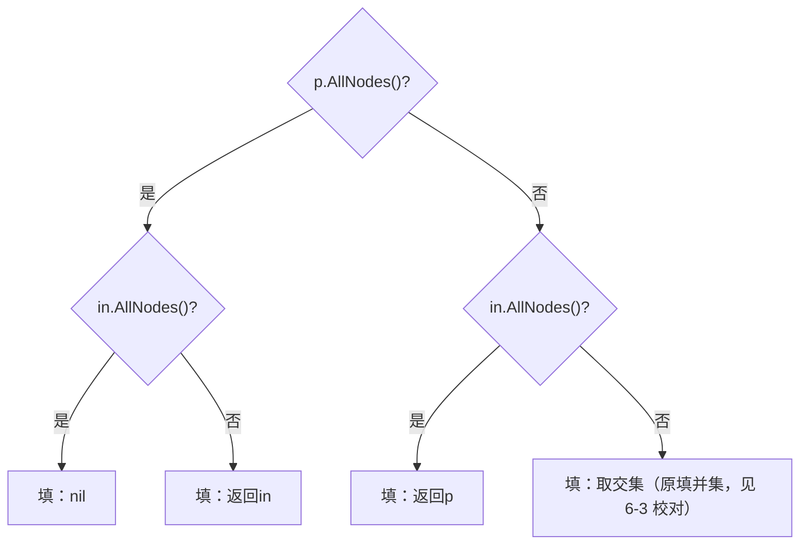

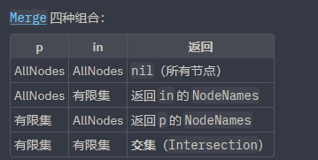

`in` 指的是**当前插件**返回的 `PreFilterResult`；`in.AllNodes()` 表示当前插件没有限制节点（`NodeNames == nil`）。

#### `framework.go:751-763` 在做什么

- `!r.AllNodes()`：当前插件限制了节点集 → 把插件名记进 `pluginsWithNodes`；
- `result = result.Merge(r)`：把当前插件的结果并入总结果；
- 如果合并后 `NodeNames` 为空：没有任何节点能**同时**满足所有 PreFilter 插件 → 返回 `UnschedulableAndUnresolvable`，消息列出 `pluginsWithNodes`。

### 6-3 第 5 步校对

| 点 | 你的答案 | 判定 | 正确表述 |
|---|---|---|---|
| `Skip` | 记录到 `SkipPlugins`，让同名 Filter 和 PreFilterExtensions 跳过 | ✅ | 消费方是 `RunFilterPlugins`（`framework.go:885`）和 PreFilterExtensions（`:794`/`:839`），不是 `schedulingCycle` |
| `UnschedulableAndUnresolvable` | 立刻返回 | ✅ | 返回 `nil, s, nil`；本轮不抢占 |
| `Unschedulable` | 记录 `returnStatus`，继续跑完 | ✅ | 跑完所有 PreFilter，最后返回 `result, returnStatus, pluginsWithNodes` |
| `Merge` 两个 false | 取并集 | 🔴 | 取**交集**（`Intersection`）；并集会让节点变多，违背「同时满足」 |
| 交集为空 | 返回 Unresolvable | ✅ | 返回 `result, UnschedulableAndUnresolvable(msg), pluginsWithNodes`；消息是 “node(s) didn't satisfy plugin(s) ... simultaneously” |

一句话：**Merge 是交集，不是并集。**

### 第 5 步要填的 4 个空

1. `Skip` 记录到哪个 state？谁消费它？
2. `UnschedulableAndUnresolvable` 和 `Unschedulable` 为什么一个立刻返回、一个继续跑？
3. `Merge` 的四种组合分别返回什么？
4. 多个插件的 `NodeNames` 交集为空时，返回什么 Status？消息怎么拼？

## 图 7：第 6 步 `findNodesThatPassFilters`（当前）

### 7-1 找多少个可行节点

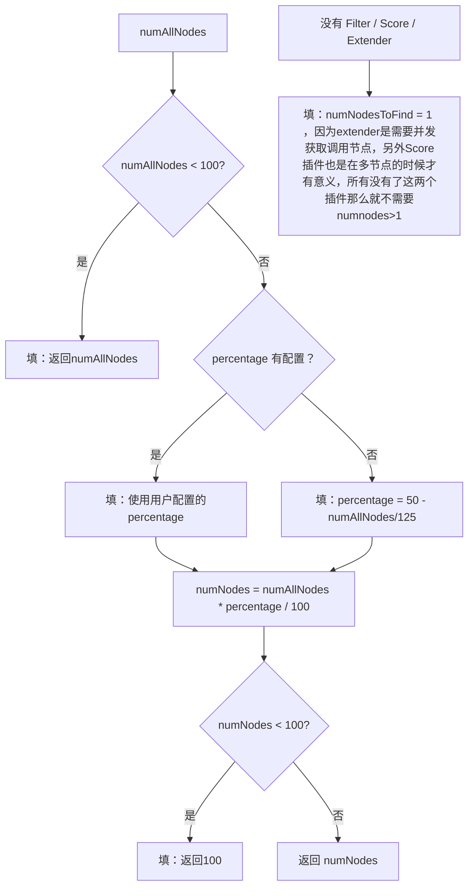

### 7-2 并行 checkNode 与提前 cancel

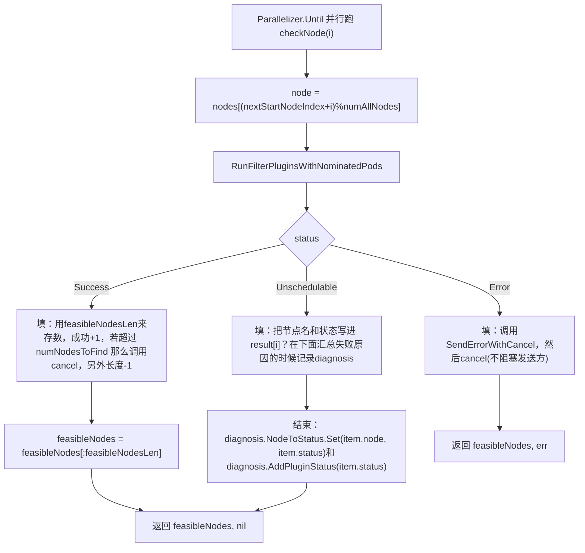

### 7-3 Nominated pods 两轮 Filter

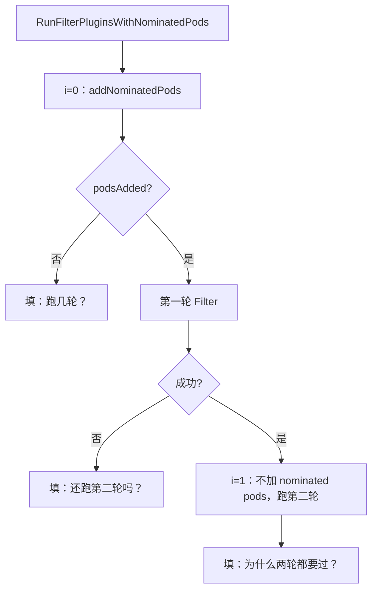

第 6 步要填的 4 个空：

1. `numFeasibleNodesToFind` 的默认公式？为什么至少 100？为什么没有 Filter/Score/Extender 时直接取 1？
2. `checkNode` 的 Error / Success / Unschedulable 三个分支分别做什么？超过 `numNodesToFind` 时为什么 cancel 并减一？
3. 提前 cancel 安全吗？会不会漏掉更优节点？
4. `RunFilterPluginsWithNominatedPods` 为什么要两轮？第一轮失败或没有提名 Pod 时怎样？

## 填空表

按「位置 / 一句话职责 / 返回值给谁 / 失败谁处理」四列填。

| 函数 | 文件:行号 | 一句话职责 | 返回值给谁 | 失败谁处理 |
|---|---|---|---|---|
| `ScheduleOne` | | | | |
| `schedulingCycle` | | | | |
| `schedulePod` | | | | |
| `findNodesThatFitPod` | | | | |
| `RunPreFilterPlugins` | | | | |
| `findNodesThatPassFilters` | | | | |
| `RunFilterPlugins` | | | | |
| `prioritizeNodes` | | | | |
| `selectHost` | | | | |
| `assume` | | | | |
| `RunReservePluginsReserve` | | | | |
| `RunPermitPlugins` | | | | |
| `bindingCycle` | | | | |
| `bind` | | | | |
| `RunBindPlugins` | | | | |
| `DefaultBinder.Bind` | | | | |
| `finishBinding` | | | | |
| `RunPostBindPlugins` | | | | |

## 自查清单

填完后逐条自问，答不出就回到图里补：

- [ ] 4 个短路口分别在什么条件触发？各自返回什么？
- [ ] `ErrNoNodesAvailable` 和 `FitError` 对抢占的影响有什么不同？
- [ ] 为什么 0 可行节点时 `EvaluatedNodes` 是 0？
- [ ] 默认日志级别能看到什么？`-v=4` 多看到什么？
- [ ] PreFilter 如何缩小节点集？Filter 的失败原因写到哪里？
- [ ] PostFilter 什么时候跑？跑完返回什么 Status？
- [ ] `go func` 在哪一行？之前必须完成哪三件事？
- [ ] `Reserve` / `Permit` 失败时，退账的两个动作是什么？

## 用法

1. 先只看图，不看文档，用 10–15 分钟填。
2. 填不出的空写「断了」，这就是下一轮的盲区。
3. 对照 `docs/review-2026-11-18.md` 和 `docs/SCHEDULER_STUDY_GUIDE.md` 批改。
4. 把错的写进 `progress.md` 的盲区台账，下一次验收先考这些。

## 怎么改图（Zed / GitHub）

- Markdown 预览是**只读**的；改的是 `.md` 文件里的 `mermaid` 代码块。
- 把 `填「...」` 替换成你的答案，保留外面的 `["..."]` 或 `{"..."}` 结构。
- 示例：
  ```text
  A["0 入队：填「谁把 Pod 放进 activeQ」"]
  ↓ 改成
  A["0 入队：informer → addPodToSchedulingQueue → activeQ"]
  ```
- Zed：命令面板 → `Markdown: Open Preview`；改源码后预览自动刷新。
- GitHub：点铅笔编辑代码块，切到 Preview 看渲染；PR review 里只能评论/建议，不能直接拖动节点。
- 不想碰 Mermaid 语法：直接填下面的「填空表」，效果一样。
