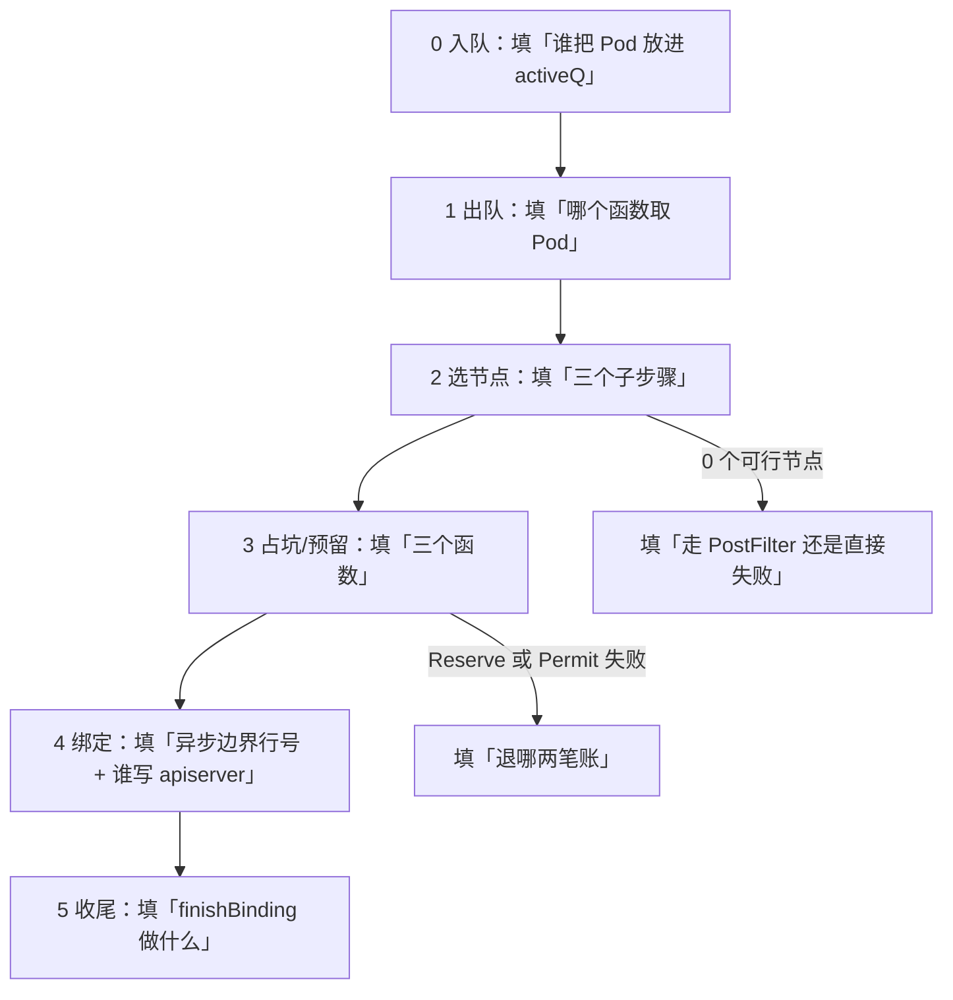
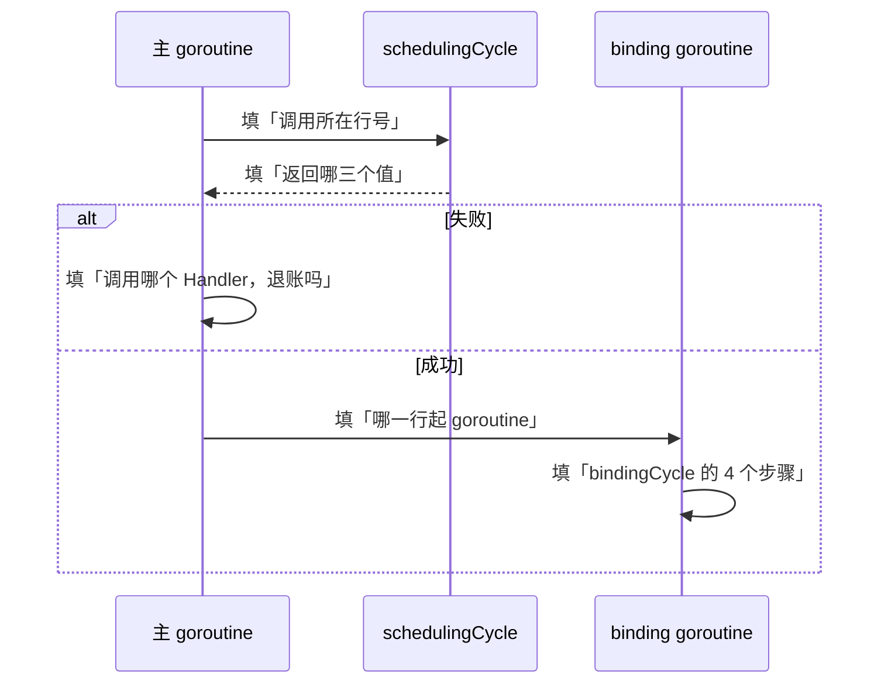
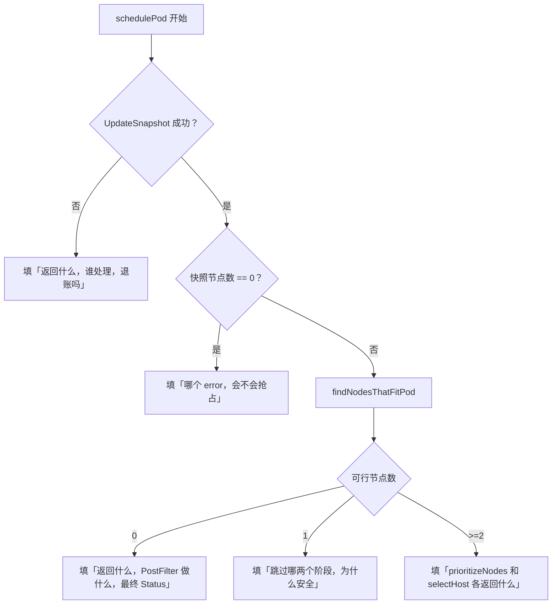
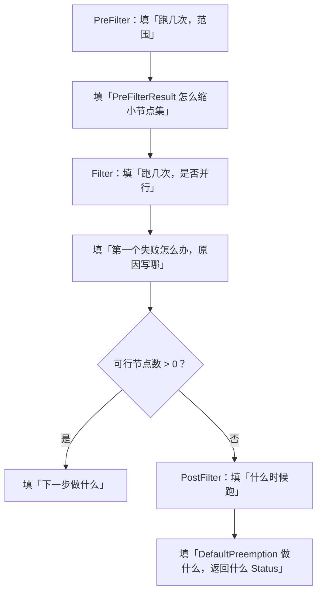
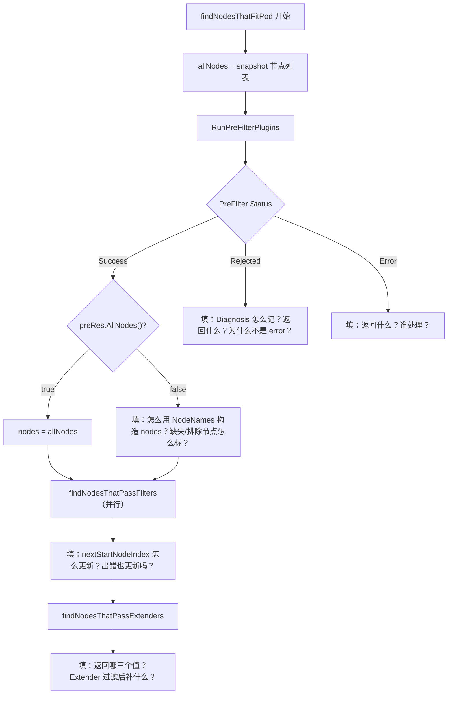
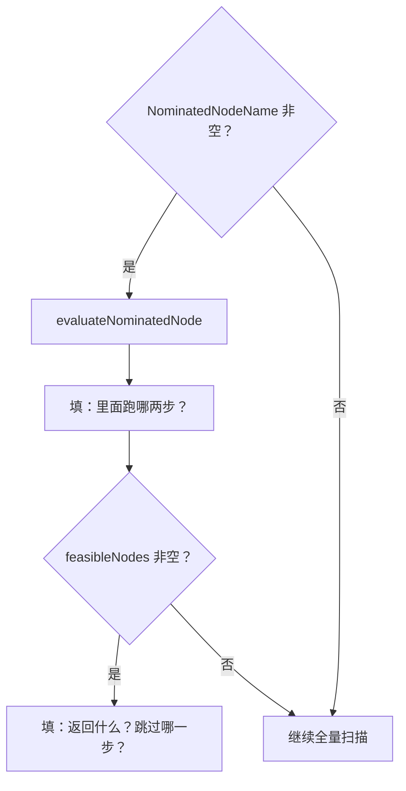

# T1-1 流程图填空练习（自己填细节）

> 用途：不看书，先把图里的 `填「...」` 补上，再对照答案。图只是骨架，细节由你填。
> 规则：每个空都按「输入 / 输出 / 失败谁处理」三样写；填不出就写「断了」，不要猜。
> 对照答案：`docs/SCHEDULER_STUDY_GUIDE.md`、`docs/review-2026-11-18.md`、`docs/SCHEDULER_CALLCHAIN.md`。

## 图 1：主干 6 阶段（粗颗粒）



## 图 2：`ScheduleOne` 的同步 / 异步分叉



## 图 3：`schedulePod` 的四个短路口（重点）



## 图 4：PreFilter / Filter / PostFilter



## 图 5：第 4 步 `findNodesThatFitPod`（当前）

### 5-1 主流程与 PreFilter 的三种 Status



### 5-2 `NominatedNodeName` 提前返回



### 5-3 `Diagnosis` 的四个字段

| 字段 | 谁写 | 什么时候写 |
|---|---|---|
| `NodeToStatus` | 填 | 填 |
| `UnschedulablePlugins` | 填 | 填 |
| `PreFilterMsg` | 填 | 填 |
| `PostFilterMsg` | 填 | 填 |

本步要填的 4 个空：

1. PreFilter `Rejected` 分支：Diagnosis 怎么记、返回什么、为什么不是 error？
2. PreFilter `Error` 分支：返回什么、谁处理？
3. `preRes.NodeNames` 怎么构造 `nodes`？缺失节点和排除节点怎么标？
4. `nextStartNodeIndex` 怎么更新？为什么出错也更新？

## 填空表

按「位置 / 一句话职责 / 返回值给谁 / 失败谁处理」四列填。

| 函数 | 文件:行号 | 一句话职责 | 返回值给谁 | 失败谁处理 |
|---|---|---|---|---|
| `ScheduleOne` | | | | |
| `schedulingCycle` | | | | |
| `schedulePod` | | | | |
| `findNodesThatFitPod` | | | | |
| `RunPreFilterPlugins` | | | | |
| `findNodesThatPassFilters` | | | | |
| `RunFilterPlugins` | | | | |
| `prioritizeNodes` | | | | |
| `selectHost` | | | | |
| `assume` | | | | |
| `RunReservePluginsReserve` | | | | |
| `RunPermitPlugins` | | | | |
| `bindingCycle` | | | | |
| `bind` | | | | |
| `RunBindPlugins` | | | | |
| `DefaultBinder.Bind` | | | | |
| `finishBinding` | | | | |
| `RunPostBindPlugins` | | | | |

## 自查清单

填完后逐条自问，答不出就回到图里补：

- [ ] 4 个短路口分别在什么条件触发？各自返回什么？
- [ ] `ErrNoNodesAvailable` 和 `FitError` 对抢占的影响有什么不同？
- [ ] 为什么 0 可行节点时 `EvaluatedNodes` 是 0？
- [ ] 默认日志级别能看到什么？`-v=4` 多看到什么？
- [ ] PreFilter 如何缩小节点集？Filter 的失败原因写到哪里？
- [ ] PostFilter 什么时候跑？跑完返回什么 Status？
- [ ] `go func` 在哪一行？之前必须完成哪三件事？
- [ ] `Reserve` / `Permit` 失败时，退账的两个动作是什么？

## 用法

1. 先只看图，不看文档，用 10–15 分钟填。
2. 填不出的空写「断了」，这就是下一轮的盲区。
3. 对照 `docs/review-2026-11-18.md` 和 `docs/SCHEDULER_STUDY_GUIDE.md` 批改。
4. 把错的写进 `progress.md` 的盲区台账，下一次验收先考这些。

## 怎么改图（Zed / GitHub）

- Markdown 预览是**只读**的；改的是 `.md` 文件里的 `mermaid` 代码块。
- 把 `填「...」` 替换成你的答案，保留外面的 `["..."]` 或 `{"..."}` 结构。
- 示例：
  ```text
  A["0 入队：填「谁把 Pod 放进 activeQ」"]
  ↓ 改成
  A["0 入队：informer → addPodToSchedulingQueue → activeQ"]
  ```
- Zed：命令面板 → `Markdown: Open Preview`；改源码后预览自动刷新。
- GitHub：点铅笔编辑代码块，切到 Preview 看渲染；PR review 里只能评论/建议，不能直接拖动节点。
- 不想碰 Mermaid 语法：直接填下面的「填空表」，效果一样。
